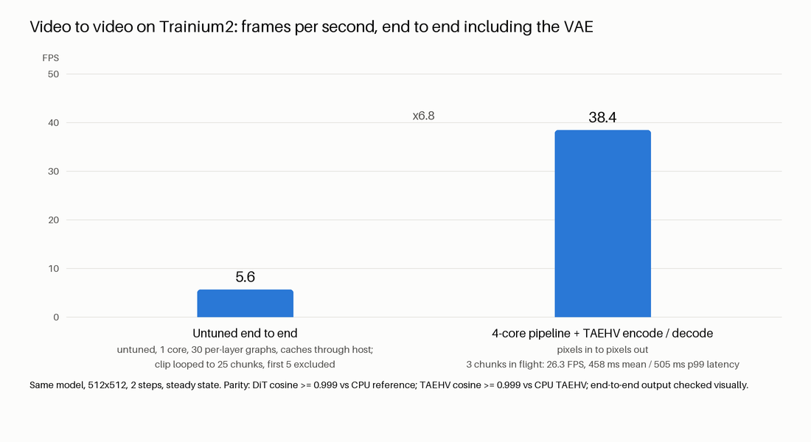
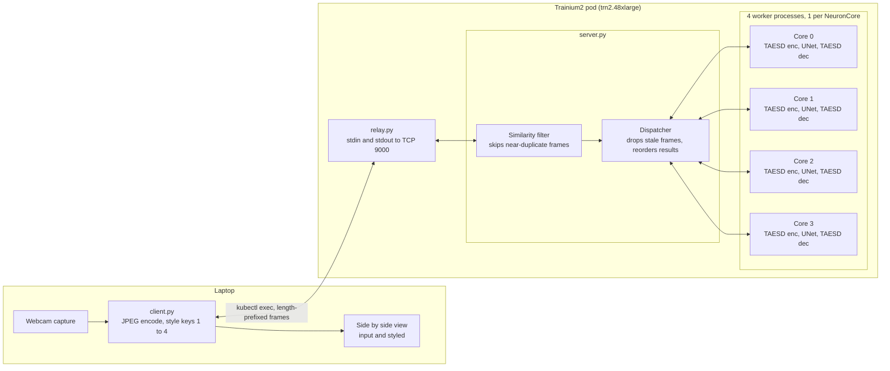
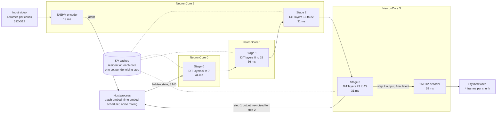

# LiveVid: real-time video diffusion on AWS Trainium2

LiveVid restyles video in real time on AWS Trainium2 (`trn2.48xlarge`) using `torch-neuronx`. It contains two
pipelines, both running fully on NeuronCores:

| Tier | Model | What it does | Measured result |
|---|---|---|---|
| **Tier 1** | SD-Turbo img2img (1 UNet step) with TAESD | Live webcam restyling, frame by frame | **43.8 FPS** on 4 cores |
| **Tier 2** | StreamDiffusionV2 causal Wan2.1 1.3B DiT with TAEHV | Temporally consistent video to video | **38.4 FPS** on 4 cores, end to end |

All numbers in this repository are measured on hardware unless a document labels them as a projection.

## Contents

- [Results](#results)
- [System design](#system-design)
- [Repository layout](#repository-layout)
- [Getting started](#getting-started)
- [Running Tier 1](#running-tier-1-live-webcam-demo)
- [Running Tier 2](#running-tier-2-causal-video-to-video)
- [Documentation](#documentation)
- [Acknowledgements](#acknowledgements)

## Results

### Tier 1: SD-Turbo img2img

512x512, 1 UNet step, TAESD encode and decode, bf16, batch 1.

| Configuration | FPS | Latency p50 |
|---|---|---|
| 1 NeuronCore | 11.2 | 89 ms |
| 4 NeuronCores, 1 frame in flight per worker | 43.2 | 92 ms |
| 4 NeuronCores, 2 frames in flight per worker | 43.8 | 182 ms |
| 4 NeuronCores with the similarity filter (threshold 3.0) | 54.8 delivered | n/a |

Each compiled component matches its CPU fp32 reference at cosine 0.9998 or better.
Details: [docs/tier1-benchmark.md](docs/tier1-benchmark.md), [docs/tier1-profile.md](docs/tier1-profile.md).

### Tier 2: causal Wan DiT, video to video

512x512, 2 denoising steps, 30 transformer blocks, 6-frame KV cache.

| Stage of the work | Scope | FPS |
|---|---|---|
| Untuned baseline: 1 core, 30 per-layer graphs, KV caches through the host | End to end | 5.6 |
| Resident KV caches, 8 layers per graph, 1 core | DiT only | 15.1 |
| Same graphs as a 4-stage pipeline, 1 core per stage | DiT only | 44.5 |
| 4-stage pipeline with TAEHV encode and decode on the same cores | End to end | **38.4** |

The tuned pipeline is 6.8x faster than the untuned baseline. With 3 chunks in flight instead of 6 it runs at
26.3 FPS with 458 ms mean and 505 ms p99 latency.



Three findings drive the speedup:

1. **Most of a block call was not compute.** Of 11.4 ms per block call, 4.2 ms was the chip executing and 7.2 ms
   was copying the KV caches between host and device.
2. **Keeping the KV caches on the device removes the copies.** The caches become aliased state of the traced
   graph (`input_output_aliases` plus `move_trace_to_device`). Grouping 8 layers per graph brings a block call
   down to 4.4 ms, which is the device execution time.
3. **The layer stack splits cleanly across cores.** Four stage graphs on four NeuronCores work on different
   chunks at the same time and give 2.96x the single-core throughput.

Correctness is gated, not assumed: the ported block matches the original at cosine 0.999993, and the full 30-block
DiT matches the original CPU pipeline at cosine 0.99996 or better and 47 to 51 dB PSNR on decoded frames.


Details: [docs/tier2-overview.md](docs/tier2-overview.md).

## System design

### Tier 1: live webcam demo

The laptop captures webcam frames and sends them as JPEG over a `kubectl exec` byte stream. A resident server on
the pod runs one worker process per NeuronCore. The scheduling policy is real time: a worker never holds more than
one frame, at most one frame waits, and a newer frame replaces a waiting one.



Inside each worker, one frame takes about 89 ms: TAESD encode (14.7 ms), one SD-Turbo UNet step (56.2 ms) and
TAESD decode (17.2 ms). The scheduler math runs on the host, and each predicted latent is blended with the previous
one to reduce flicker. Prompt embeddings for the four styles are computed once and cached.

### Tier 2: 4-core causal video-to-video pipeline

Video is processed in chunks of 4 pixel frames, which equal 1 latent frame. Each chunk makes 2 passes through the
30-block DiT, one per denoising step. The DiT is split into 4 stage graphs, each pinned to its own NeuronCore, so
up to 6 chunks are in flight at once. The KV caches never leave the device.



Key design points:

- **Static graphs.** The original block uses flash attention, complex RoPE and an in-place ring buffer. The port in
  `tier2/block_port.py` uses scaled dot-product attention, real cos and sin RoPE, and a slice-and-concat cache
  update, so every shape is fixed at trace time.
- **Resident state.** Each stage graph holds its KV caches as aliased parameters on the NeuronCore. Only the hidden
  state (3 MB) and small per-call inputs cross the host boundary.
- **Two graph instances per stage.** Each denoising step has its own caches, so every stage process loads its
  graph twice.
- **VAE co-location.** The TAEHV encoder and decoder run inside the two least-loaded stage processes (cores 2 and
  3), so no extra processes or cores are needed.
- **Throughput against latency.** The number of chunks in flight is a runtime flag (`--inflight`): 6 gives
  38.4 FPS at 629 ms mean latency, 3 gives 26.3 FPS at 458 ms.

## Repository layout

```
.
├── docs/                 Benchmarks, design notes and charts
├── scripts/              Pod access helpers, venv setup, environment probes, smoke test
├── tier1/                SD-Turbo img2img pipeline and live webcam demo
│   ├── pipeline_neuron.py    Compile and run TAESD encoder, UNet, TAESD decoder on Neuron
│   ├── server.py             Resident 4-core restyling server (runs on the pod)
│   ├── relay.py              Byte relay between kubectl exec and the server socket
│   ├── client.py             Webcam client (runs on the laptop)
│   ├── proto.py              Wire format shared by client and server
│   ├── bench.py              Latency and FPS benchmark
│   ├── quality.py            Strength, smoothing and prompt sweep
│   └── reference_cpu.py      CPU fp32 ground truth for parity checks
└── tier2/                Causal Wan DiT video-to-video pipeline
    ├── block_port.py         Static-graph rewrite of one causal Wan block
    ├── check_cpu.py          CPU parity of the port against the original block
    ├── g1_trace.py           Trace one block on Neuron, parity and latency
    ├── g2_*.py               Full 30-block DiT: CPU reference, Neuron run, decode, resident-cache prototype
    ├── g3_stage.py           Compile one multi-layer stage with resident KV caches
    ├── g3_pipeline.py        4-stage DiT pipeline, 1 process per NeuronCore
    ├── g4_e2e.py             End-to-end pipeline including TAEHV encode and decode
    ├── g5_clip.py            Warm-up for running the pipeline on an arbitrary clip
    ├── vae_neuron.py         TAEHV encoder and decoder as streaming Neuron graphs
    ├── vae_resident.py       TAEHV with its temporal state resident on the device
    ├── check_ctx_compact.py  CPU check that the compact cross-attention context is exact
    ├── lnc.py                Logical NeuronCore setting shared by compile and runtime
    └── e2e.py                Untuned single-core end-to-end baseline
```

Model weights, compiled artifacts, videos and raw result files are not committed. Scripts write them to
`artifacts/`, `tier1/out/`, `tier2/out/` and `tier2/results/`, which are ignored by git.

## Getting started

### Requirements

- An AWS Trainium2 instance (`trn2.48xlarge`) reachable as a Kubernetes pod, with the Neuron SDK runtime installed.
- `kubectl` access to that pod from your machine.
- Python 3.10 or 3.11 on the pod. The setup script installs `torch-neuronx`, `neuronx-cc` 2.x, `diffusers` and the
  other dependencies with `uv`.
- For the live demo: a laptop with a webcam and a local Python venv at `venvs/client` with `opencv-python` and
  `numpy`.

The helper scripts address the pod by name. Set it in a local `.env` file at the repository root:

```
SEAT=seat-<N>
```

The Tier 1 and Tier 2 helpers (`tier1/_seat.sh`, `tier2/remote.sh`) carry default pod names from the original
cluster. Change them to match your own pod.

### Set up the pod

```bash
scripts/push.sh                               # sync the repository to /workspace/livevid on the pod
scripts/pod.sh "scripts/setup_venv.sh"        # build the torch-neuronx venv at /workspace/venvs/tnx
scripts/pod.sh "scripts/start_downloads.sh"   # download model weights and clone StreamDiffusionV2
scripts/pod.sh "scripts/run_smoke.sh"         # optional: trace a small MLP to confirm the toolchain works
```

## Running Tier 1: live webcam demo

Compile the three components once (about 4 to 8 minutes each), then prepare the scheduler constants and style
embeddings:

```bash
tier1/push.sh
tier1/remote.sh "cd tier1 && python pipeline_neuron.py compile --component taesd_enc"
tier1/remote.sh "cd tier1 && python pipeline_neuron.py compile --component unet"
tier1/remote.sh "cd tier1 && python pipeline_neuron.py compile --component taesd_dec"
tier1/remote.sh "cd tier1 && python pipeline_neuron.py prepare"
```

Start the server on the pod and the webcam client on your laptop with one command:

```bash
tier1/run_live.sh                 # keys 1 to 4 switch style, q quits
tier1/run_live.sh --record        # also save the side-by-side view
```

Available styles: `anime`, `claymation`, `oil_painting`, `pixel_art`.

To reproduce the benchmark:

```bash
tier1/remote.sh "cd tier1 && python make_clip.py && python bench.py"
```

## Running Tier 2: causal video to video

Tier 2 needs a short 512x512 test clip at `tier2/data/test_clip.mp4`. Supply your own, or generate a synthetic
one with `tier1/make_clip.py --out ../tier2/data/test_clip.mp4`.

```bash
tier2/remote.sh push

# 1. One block: CPU parity, then trace and check on Neuron
tier2/remote.sh run "python -u check_cpu.py"
tier2/remote.sh run "python -u g1_trace.py compile && python -u g1_trace.py parity"

# 2. Full 30-block DiT against the original pipeline on CPU
tier2/remote.sh run "./g2_ref_all.sh"
tier2/remote.sh run "./g2_compile_all.sh"
tier2/remote.sh run "./g2_run_all.sh"

# 3. Four resident-cache stage graphs, then the 4-core DiT pipeline
tier2/remote.sh run "./g3_compile_all.sh"
tier2/remote.sh run "./g3_run_all.sh"

# 4. TAEHV encoder and decoder, then the end-to-end pipeline
tier2/remote.sh run "python -u vae_neuron.py compile enc && python -u vae_neuron.py compile dec"
tier2/remote.sh run "python -u vae_neuron.py ref && python -u vae_resident.py"   # optional: TAEHV state on the device
tier2/remote.sh run "python -u g4_e2e.py --chunks 120"
tier2/remote.sh run "python -u g4_e2e.py --chunks 120 --inflight 3"   # lower latency
```

`g4_e2e.py` uses the resident TAEHV graphs when `vae_resident.py` has saved them (`--vae host` for the original
path). The 38.4 FPS figure above was measured with the host-state graphs. Stage split, cores, VAE placement, a
compact cross-attention context, LNC=1 builds and a 1-step mode are all options; see
[docs/pipeline-options.md](docs/pipeline-options.md). None of their effects has been measured on hardware yet.

To stylize your own clip:

```bash
tier2/remote.sh run "NEURON_RT_VISIBLE_CORES=0 python -u g5_clip.py data/my_clip_512.mp4"
tier2/remote.sh run "python -u g4_e2e.py --clip data/my_clip_512.mp4 --out out/my_clip_styled.mp4"
```

## Documentation

| Document | Contents |
|---|---|
| [docs/tier1-benchmark.md](docs/tier1-benchmark.md) | Tier 1 compile times, per-stage latency, multi-core FPS, similarity filter |
| [docs/tier1-profile.md](docs/tier1-profile.md) | Tier 1 per-core utilization and UNet device profile |
| [docs/tier2-overview.md](docs/tier2-overview.md) | Tier 2 from one block to the 4-core end-to-end pipeline, with all measurements |
| [docs/tier2-block-port.md](docs/tier2-block-port.md) | Porting one causal Wan block to a static Neuron graph, parity results |
| [docs/tier2-shapes.md](docs/tier2-shapes.md) | Tensor shapes and the operations that had to be replaced |
| [docs/tier2-pipeline-notes.md](docs/tier2-pipeline-notes.md) | Pass count per chunk, VAE path, device profile of a block call |
| [docs/tier2-vae.md](docs/tier2-vae.md) | TAEHV encoder and decoder on Neuron: parity, quality, latency |
| [docs/tier2-e2e-baseline.md](docs/tier2-e2e-baseline.md) | Untuned single-core end-to-end baseline |
| [docs/pipeline-options.md](docs/pipeline-options.md) | Stage split, resident TAEHV, compact context, LNC=1, 1-step mode: what each does and how to measure it |

## Known limitations

- Tier 2 session start (the first 2 latent frames) still runs on CPU, because the traced block graph is fixed at
  one latent frame per chunk.
- End-to-end Tier 2 output is checked visually. Numeric parity is established separately for the DiT and the VAE.
- The adaptive sink refresh and the RoPE position rewind of the original pipeline are not implemented in the
  host code, so parity is only claimed for the first frames of a stream.
- The four Tier 2 stages are not balanced. Stage 0 takes 44 ms against 31 ms for stages 2 and 3.

## Acknowledgements

- [StreamDiffusionV2](https://github.com/chenfengxu714/StreamDiffusionV2) for the causal Wan video-to-video model
  and pipeline.
- [Wan2.1](https://github.com/Wan-Video/Wan2.1) for the base video diffusion model.
- [SD-Turbo](https://huggingface.co/stabilityai/sd-turbo) by Stability AI.
- [TAESD and TAEHV](https://github.com/madebyollin/taehv) by Ollin Boer Bohan for the tiny autoencoders.
- The AWS Neuron SDK (`torch-neuronx`, `neuronx-cc`) for compilation and runtime on Trainium2.
