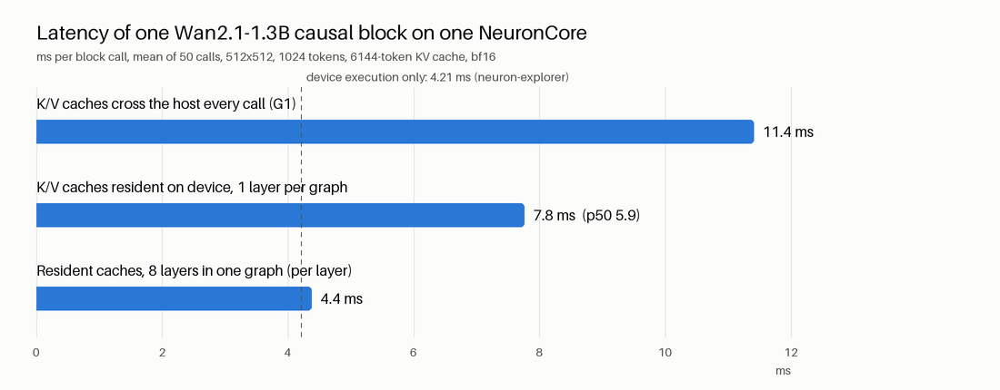

# Tier 2 story: StreamDiffusionV2's causal Wan DiT on Trainium2

Track 2, seat-234 (trn2.48xlarge, one logical NeuronCore unless stated), 2026-10-10. Model: Wan2.1-T2V-1.3B causal
DiT from `jerryfeng/StreamDiffusionV2` (`wan_causal_dmd_v2v`), demo config: 512x512, 2 denoising steps, 6-frame KV
cache. Everything below is measured except the section marked **Projection**.

## The short version

1. **It runs and it is correct.** One causal block with a fixed-size KV cache matches CPU at cosine 0.999993
   (G1). All 30 blocks, denoising real video for 6 chunks with the cache carried forward, match the original repo
   pipeline at cosine >= 0.99996 and 47 to 51 dB PSNR on decoded frames.
2. **Most of the block's time was not compute.** Of 11.4 ms per block call, 4.2 ms is the chip executing; 7.2 ms
   is moving the KV caches to the device and back.
3. **Keeping the caches on the device and grouping layers gets it back.** 11.4 ms -> 4.4 ms per block, which is
   the device execution time.

## 1. G1: one block, fixed-size KV cache, on Neuron

- Rewrote `CausalWanAttentionBlock` for a static graph (`tier2/block_port.py`): flash_attn -> scaled dot-product
  attention, complex RoPE -> real cos/sin, the repo's in-place ring buffer -> a slice-and-concat cache update
  with the 3 sink frames passed through.
- CPU check against the original repo block: cosine 1.0000000 (max abs error 1e-5) over 9 consecutive chunks.
- Traced in bf16 at the exact demo shapes (x 1024 tokens, cache 6144 tokens): compile 26.6 s.
- 3 consecutive chunks, Neuron vs CPU, each feeding its own caches forward: y 0.999993, K cache 0.999996,
  V cache 0.999997. **Gate 0.999: pass.** Details: `reports/g1.md`.

## 2. Where the 11.4 ms goes

`neuron-explorer` profile of the same block (`tier2/G2_NOTES.md`, section c).

| | ms per call | share |
|---|---|---|
| Wall time seen by the host | 11.41 | 100% |
| Device execution | 4.21 | 37% |
| Host<->device copies + call overhead | 7.20 | 63% |

- Each call carried about 43 MB in and 41 MB out; the two KV caches are 89% of that.
- Inside the 4.21 ms of device time: tensor engine (matmuls) active 68% of the time, DMA active 49% (they
  overlap).
- **Percent of peak.** One block call is 132.1 GFLOP (counted with `torch.utils.flop_counter`). Peak used:
  130.7 TFLOPS per logical NeuronCore, the figure implied by the profiler's own utilisation number (not a
  published spec).

| Basis | Throughput | % of peak |
|---|---|---|
| Wall clock, caches through the host (11.41 ms) | 11.6 TFLOPS | 8.9% |
| Device execution only (4.21 ms) | 31.4 TFLOPS | 24% |
| Resident caches, 8 layers per graph (4.37 ms) | 30.2 TFLOPS | 23% |

## 3. KV cache resident on the device

Mechanism: the caches become parameters of the traced module and `torch_neuronx.trace(..., input_output_aliases=
{param: output_index})` marks each new-cache output as that parameter's next value;
`torch_neuronx.move_trace_to_device` then keeps them on the NeuronCore. Same input/output aliasing NxD Inference
uses for LLM KV caches. Only x, the time modulation, the text context, RoPE and the bias cross the host.
Script: `tier2/g2_resident.py`.

| One layer per graph | Caches through host (G1) | Caches resident |
|---|---|---|
| Latency, mean | 11.41 ms | **7.76 ms** |
| Latency, p50 | 11.39 ms | **5.91 ms** |
| Latency, p99 | 11.67 ms | 29.2 ms |
| y cosine vs CPU, 3 consecutive chunks | 0.999993 to 0.999994 | 0.999994, 0.999994, 0.999994 |
| y max abs error | 0.18 to 0.21 | 0.18 to 0.21 |
| Compile | 26.6 s | 25.2 s |

- Parity is unchanged from G1.
- The state really advances on the device: comparing against a CPU run whose cache is frozen, the effect of the
  updated state matches at cosine 0.994 (the effect is small in layer 0, RMS 0.02, so bf16 noise shows).
- The p99 is worse (occasional 29 ms calls); the mean is pulled up by those. Not yet investigated.

## 4. Several layers in one graph

8 blocks (layers 0 to 7, real weights) chained in one graph with 16 resident cache tensors.

| | Value |
|---|---|
| Latency for all 8 layers, mean / p50 / p99 | 34.96 / 34.95 / 35.18 ms |
| **Per layer** | **4.37 ms** |
| y cosine vs CPU after 8 layers, 3 consecutive chunks | 0.999973, 0.999966, 0.999973 |
| State-effect cosine vs CPU (chunks 2 and 3) | 0.9978, 0.9995 |
| Compile | 183 s |

Per-layer latency is now within 4% of the profiled device execution time (4.21 ms), and the tail is gone
(p99 35.2 ms for 8 layers).

## 5. Full pipeline today (measured, caches still through the host)

All 30 layers as 30 single-layer graphs, 6 chunks of real video, against the original repo pipeline on CPU.

| | |
|---|---|
| Latent cosine per chunk, final output row | 0.999981, 0.999977, 0.999972, 0.999963, 0.999960 |
| Decoded-frame PSNR vs CPU reference | 50.8, 50.4, 49.9, 47.9, 47.1 dB |
| DiT time per chunk (60 block calls) | 0.65 s |
| **DiT-only FPS, one core** | **6.1** |

Video: `tier2/out/g2_side_by_side.mp4` (input | CPU reference | Neuron). The Neuron output is visually identical
to the reference. Cosine drifts down slowly with chunk count; longer runs should be checked.

## 6. Projection (not measured end to end)

Built from the measured 4.37 ms per layer with resident caches and 8-layer graphs. Assumptions: all 30 layers
cost the same as layers 0 to 7; 2 DiT passes per chunk (true for this pipeline, there is no extra cache pass);
4 output frames per chunk; DiT only.

| Scenario | Time per chunk | FPS | Status |
|---|---|---|---|
| Today: 30 single-layer graphs, caches through host, 1 core | 0.65 s | 6.1 | measured |
| Resident caches + grouped layers, 1 core | 4.37 ms x 30 x 2 = 0.262 s | **15** | projection |
| Same, 4 cores (the 2 passes x 2 halves of the stack, one per core) | 0.262 s latency, one chunk out every 0.066 s | **61** | projection |

What the projection leaves out, and why it is optimistic:

- **VAE.** Not on Neuron yet. On CPU it dwarfs the DiT: Wan VAE encode 12 s and decode 16 s per chunk, TAEHV
  decode 0.7 s per chunk (CPU timings taken under load, indicative). `--use_taehv` only replaces the decoder; the
  encoder is still the full Wan VAE. Real-time needs both on Neuron.
- **4-core scaling is assumed linear** and assumes the 3 MB hidden state can hop between cores cheaply. Neither is
  measured. The 4-core figure is throughput; latency per chunk stays 0.26 s.
- **Cache warm-up in graph.** The resident prototype covers steady state. Filling the 3 sink slots during the
  first chunks is still done on the host today and has to move into the graph (or a second graph) before the
  resident version can run a whole session.
- Session start (a 2-frame chunk), adaptive sink refresh and the 50-frame RoPE rewind are still host / CPU side.

## Errors and caveats, verbatim where there was an error

- Reading an aliased cache back to the host failed:
  `RuntimeError('Expected self.dtype() == dst.dtype() to be true, but got false.  (Could this error message be
  improved?  If so, please report an enhancement request to PyTorch.)')`. Parity was therefore checked through y
  and the state-effect metric, not by reading the on-device caches.
- `kubectl exec` dropped several file pulls (`websocket: close 1006 (abnormal closure): unexpected EOF`,
  `connection reset by peer`); retried, no data affected.
- A first run of the 30-layer script crashed on a host-side shape bug of mine
  (`RuntimeError: permute(sparse_coo): number of dimensions in the tensor input does not match ...`); fixed and
  rerun, numbers above are from the rerun.
- `torch.utils.flop_counter` does not count `scaled_dot_product_attention`; FLOPs were counted on the equivalent
  matmul + softmax path.

## Where things are

Branch `tier2-g1`. `tier2/SHAPES.md` (shapes and non-portable ops), `tier2/G2_NOTES.md` (pass count, VAE path,
profile), `reports/g1.md`, raw numbers in `tier2/results/`, videos and chart in `tier2/out/`. Neuron artifacts on
seat-234 under `/workspace/livevid/artifacts/tier2/`.
